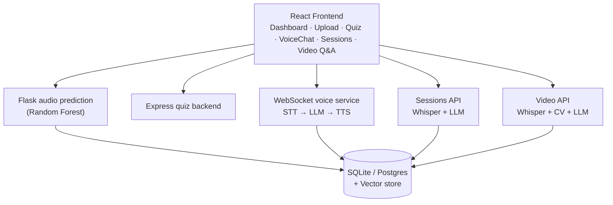

# 🧩 Autism Detection for Early Childhood

[]()
[](https://react.dev/)
[]()
[]()

> A multi-modal autism screening support system for early childhood using voice, photo, video, and questionnaire-based analysis, with a voice assistant for guidance and an AI consultation summarizer for doctor/therapist visits.


---

## ✨ Features
Core features
🎤 Voice Analysis - Upload audio files; ML model predicts autistic tendencies
📸 Photo Analysis - Upload photos for facial/emotion-based assessment
📝 Quiz Detection - 15-question early childhood autism questionnaire
👤 User Accounts - Signup/Login for parents/guardians
📊 Dashboard - Sidebar navigation for all features
💬 Feedback & Chatbot - Interactive support and guidance
🔒 Privacy First - Data handled locally; secure

---

## 📱 Screenshots

<p align="center">
  
  
  
  
  
</p>


---
##🆕 New features
🗣️ Low-Latency Voice Assistant - Talk to the chatbot hands-free. Streaming speech-to-text → LLM → text-to-speech, with interruption handling (speak while the assistant is talking and it stops immediately).
📋 Consultation Summarizer - Upload a recording of a doctor/therapist visit. Get a transcript with speaker labels (Parent / Doctor), a structured summary, action items, and a searchable archive.
🎬 Video Q&A - Upload a video of your child and ask questions such as "When did the child make eye contact?". Answers come with clickable timestamps that jump the video to the right moment.

## 🏗️ Architecture
 
### Tech stack
 
| Layer | Technology |
|---|---|
| **Frontend** | React.js, React Router, CSS |
| **Backend (audio prediction)** | Flask |
| **Backend (quiz)** | Node.js / Express |
| **Backend (new AI services)** | Flask / FastAPI, WebSockets |
| **ML models** | Scikit-learn Random Forest, Librosa, Joblib |
| **Audio processing** | Pydub, FFmpeg |
| **Speech-to-text** | faster-whisper (local), Silero VAD |
| **Speaker labeling** | pyannote.audio |
| **Text-to-speech** | Piper (local) |
| **LLM** | Ollama (local, default) or a cloud LLM (optional, see [Privacy](#-privacy-consent--safety)) |
| **Video processing** | OpenCV, MediaPipe, vision-language model for captions |
| **Search / embeddings** | ChromaDB or SQLite + FAISS |
| **Database** | SQLite / PostgreSQL (replaces LocalStorage for records) |
 
### High-level flow
 

 
---
 
## 🧠 How the New Features Work
 
<details>
<summary><b>🗣️ Low-Latency Voice Assistant</b></summary>
<br>
1. The browser streams microphone audio to the backend over a **WebSocket**.
2. **Silero VAD** detects when the user starts and stops speaking.
3. **faster-whisper** transcribes speech to text.
4. The LLM streams its reply token by token. The first complete sentence goes to **Piper TTS** immediately, so the assistant starts speaking before the full answer is generated.
5. **Interruption handling:** if VAD detects the user speaking while the assistant is talking, the LLM stream is cancelled and audio playback stops.
6. The app logs **response latency** (end of user speech → first audio) for performance tracking.
A lightweight fallback using the browser's built-in Web Speech API is available when the streaming backend is not running.
 
</details>
<details>
<summary><b>📋 Consultation Summarizer</b></summary>
<br>
1. Upload a recording (converted via the existing Pydub/FFmpeg pipeline).
2. Transcribe with **faster-whisper** (timestamped).
3. Label speakers (Parent / Doctor) with **pyannote.audio** diarization.
4. An LLM produces structured JSON: `summary`, `parent_concerns`, `recommendations`, `action_items`, `follow_up_date`.
5. Transcript chunks are embedded and stored for search.
6. Ask questions like *"What did the doctor say about speech therapy?"* and get an answer with the matching timestamp.
</details>
<details>
<summary><b>🎬 Video Q&A</b></summary>
<br>
1. Extract audio and transcribe with timestamps.
2. Sample frames every 2-3 seconds with **OpenCV**.
3. Caption each segment with a vision-language model and compute behavior signals with **MediaPipe** (gaze direction, response to name call, repetitive movement).
4. Store each segment as `{start, end, transcript, caption, signals}` and embed it.
5. For a question, retrieve the best-matching segments, have the LLM answer, and return the timestamps.
6. In the UI, timestamps are clickable and seek the video player.
> Video and voice outputs are phrased as **observations** (for example, "child did not turn when name was called at 0:42"), never as a diagnosis.
 
</details>
---
 
## 🚀 Usage
 
1. Sign up / log in as a parent or guardian and **accept the consent screen**.
2. Use the **Dashboard** to choose:
| Option | What it does |
|---|---|
| 📸 **Upload Photo** | AI analysis of facial expressions |
| 🎤 **Upload Voice** | Audio-based prediction |
| 📝 **Quiz** | Questionnaire-based assessment |
| 🎬 **Video Analysis** | Upload a video and ask questions about it |
| 📋 **Consultation Notes** | Upload and search doctor/therapist visit recordings |
| 🗣️ **Voice Assistant** | Talk to the chatbot hands-free |
 
3. View prediction results.
4. Access Feedback & Chatbot.
---
 
## 📁 Project Structure
 
```
Autism-Detection-Project/
├─ backend/
│  ├─ audio_api.py          # Flask server for audio prediction
│  ├─ rf.pkl                # Random Forest model
│  ├─ voice_ws.py           # NEW: streaming voice assistant (WebSocket)
│  ├─ sessions_api.py       # NEW: consultation summarizer + search
│  ├─ video_api.py          # NEW: video Q&A
│  ├─ db.py                 # NEW: SQLite/Postgres data layer
│  ├─ requirements.txt
│  └─ .env.example
├─ quiz-backend/
│  └─ servers.js            # Express server for quiz
├─ frontend/
│  ├─ public/
│  │  └─ dashboard_bg.jpg   # Background images
│  └─ src/
│     ├─ component/
│     │  ├─ Dashboard.jsx
│     │  ├─ UploadVoice.jsx
│     │  ├─ UploadPhoto.jsx
│     │  ├─ Quiz.jsx
│     │  ├─ VoiceChat.jsx   # NEW
│     │  ├─ Sessions.jsx    # NEW
│     │  ├─ UploadVideo.jsx # NEW
│     │  └─ Consent.jsx     # NEW
│     └─ App.jsx
└─ README.md
```
 
---
 
## ⚙️ Installation
 
### Prerequisites
 
- Node.js 18+
- Python 3.10+
- FFmpeg installed and available on your PATH
- (Recommended) [Ollama](https://ollama.com) for a fully local LLM
- A Hugging Face token (required by pyannote.audio for speaker labeling)
### 1. Clone
 
```bash
git clone https://github.com/kvya6/autism-detection-for-early-childhood.git
cd autism-detection-for-early-childhood
```
 
### 2. Backend (Python)
 
```bash
cd backend
python -m venv venv
source venv/bin/activate        # Windows: venv\Scripts\activate
pip install -r requirements.txt
cp .env.example .env            # then edit values
```
 
<details>
<summary><b>Suggested <code>requirements.txt</code> additions</b></summary>
```
flask
flask-cors
flask-sock
fastapi
uvicorn
librosa
pydub
joblib
scikit-learn
faster-whisper
silero-vad
pyannote.audio
piper-tts
opencv-python
mediapipe
chromadb
sqlalchemy
```
 
</details>
**Example `.env`:**
 
```env
LLM_PROVIDER=ollama             # ollama | cloud
OLLAMA_MODEL=llama3.1
WHISPER_MODEL=small
HF_TOKEN=your_huggingface_token
DATABASE_URL=sqlite:///autism_app.db
```
 
**Run the services:**
 
```bash
python audio_api.py             # audio prediction
python voice_ws.py              # voice assistant (WebSocket)
python sessions_api.py          # consultation summarizer
python video_api.py             # video Q&A
```
 
### 3. Quiz backend (Node.js)
 
```bash
cd quiz-backend
npm install
node servers.js
```
 
### 4. Frontend (React)
 
```bash
cd frontend
npm install
npm start
```
 
The app runs at **http://localhost:3000**.
 
---
 
## 🔒 Privacy, Consent & Safety
 
- **Local by default:** with `LLM_PROVIDER=ollama`, all transcription, speech synthesis, LLM calls and video analysis run on your machine and no child data leaves it.
- **Cloud option:** if you switch `LLM_PROVIDER` to a cloud service, transcripts and summaries are sent to that provider. In this mode the "data handled locally" guarantee **no longer applies**, so inform users and obtain explicit consent.
- **Parental consent:** the app shows a consent screen before any child's audio, photo or video is processed. If you deploy in India, review obligations under the **Digital Personal Data Protection Act, 2023** (including verifiable parental consent).
- **Data control:** users can delete their recordings, transcripts and results at any time.
- **No diagnosis:** all outputs are screening observations. The app always recommends consulting a qualified professional.
---
 
## 📊 Evaluation & Limitations
 
- The Random Forest audio model is trained on a limited dataset. Report precision, recall and F1, not accuracy alone, and treat results as indicative only.
- Photo and video analysis can be affected by lighting, camera angle, age and cultural differences in expression, and may produce false positives or negatives.
- Voice assistant latency is measured (end of speech → first audio) and logged; the target is under ~1.5 seconds on a modern laptop with a small Whisper model.
- Speaker labeling accuracy drops with overlapping speech and noisy rooms.
---
 
## 🗺️ Roadmap
 
- [x] Voice, photo and quiz screening
- [x] User accounts and dashboard
- [x] Feedback & chatbot
- [ ] Streaming voice assistant with interruption handling
- [ ] Consultation summarizer with searchable archive
- [ ] Video Q&A with timestamped answers
- [ ] Migrate LocalStorage to SQLite/Postgres
- [ ] Multi-language support (Hindi, Kannada, Tamil, etc.)
- [ ] Clinician-facing report export (PDF)
---
 
## 🤝 Contributing
 
Contributions are welcome. Please open an issue to discuss major changes before submitting a pull request.
 
---
 
## 🙏 Acknowledgements
 
Librosa, scikit-learn, faster-whisper, Silero VAD, pyannote.audio, Piper, OpenCV, MediaPipe, Ollama and the open-source community.
 
---
 
<div align="center">
Made with ❤️ for early childhood care
 
</div>
